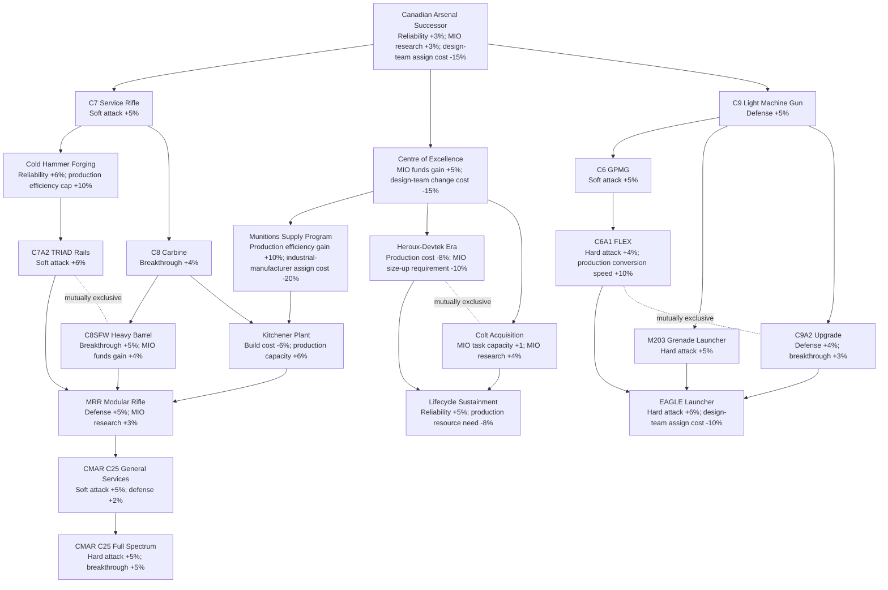
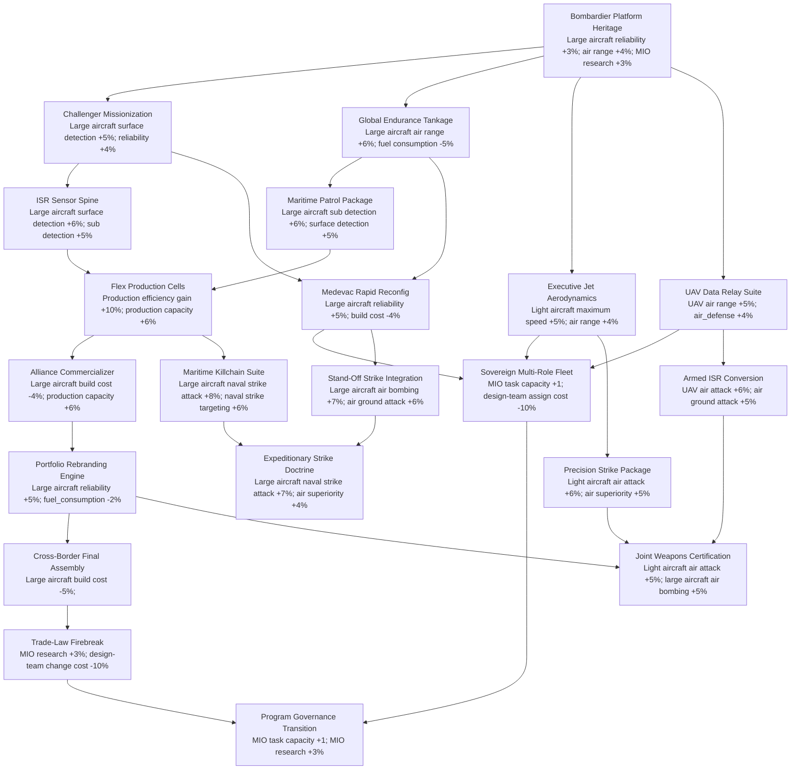
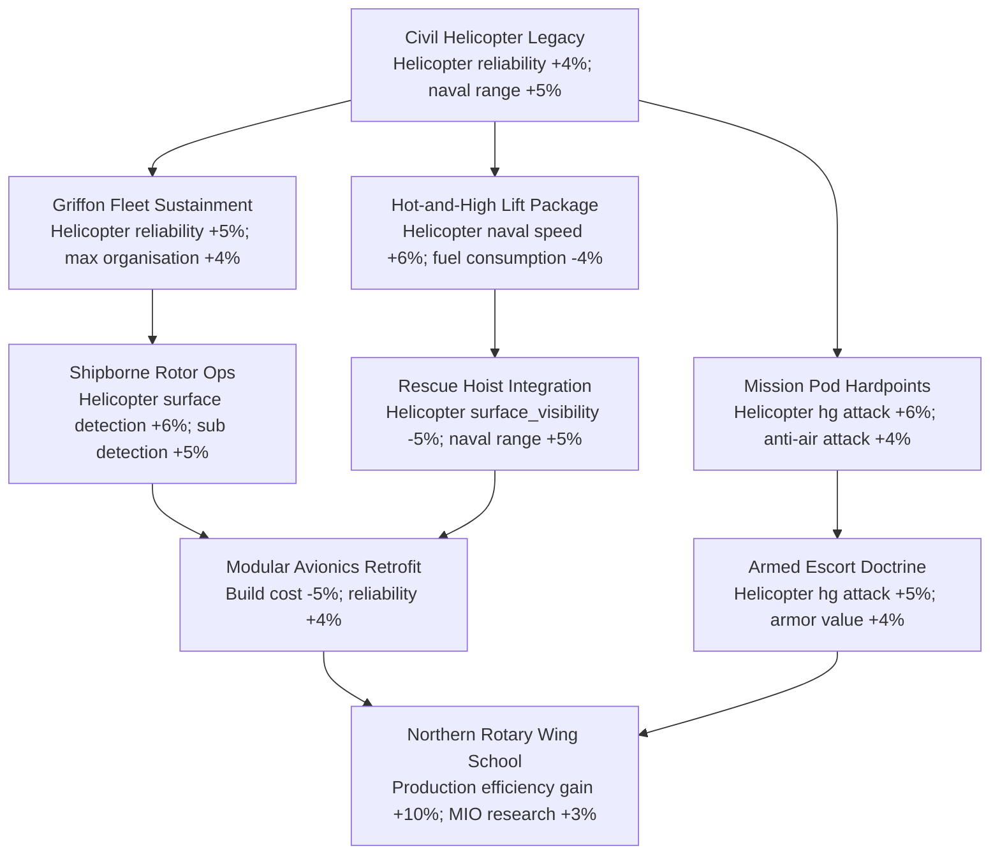
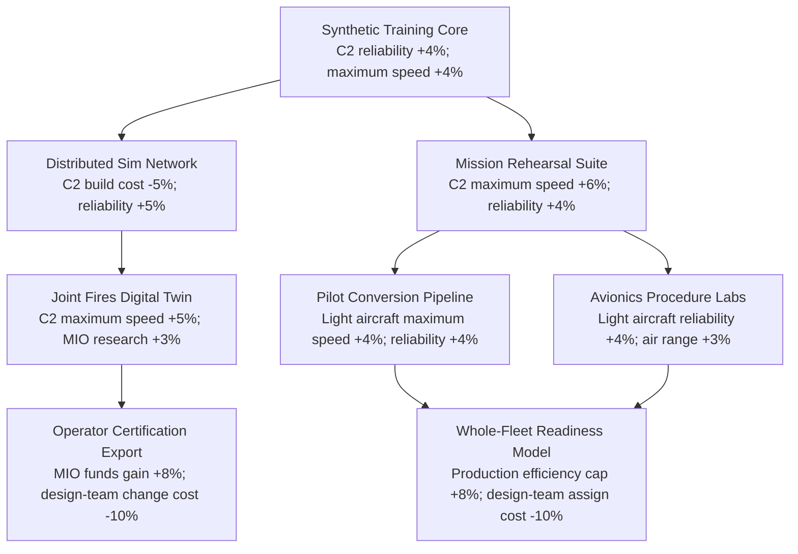
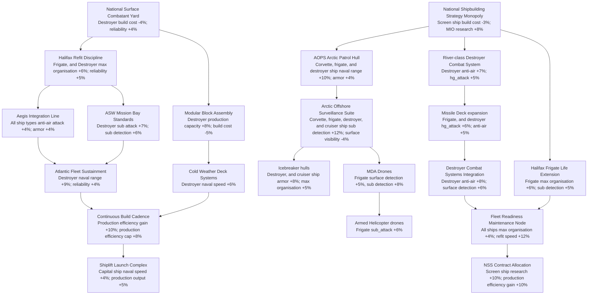
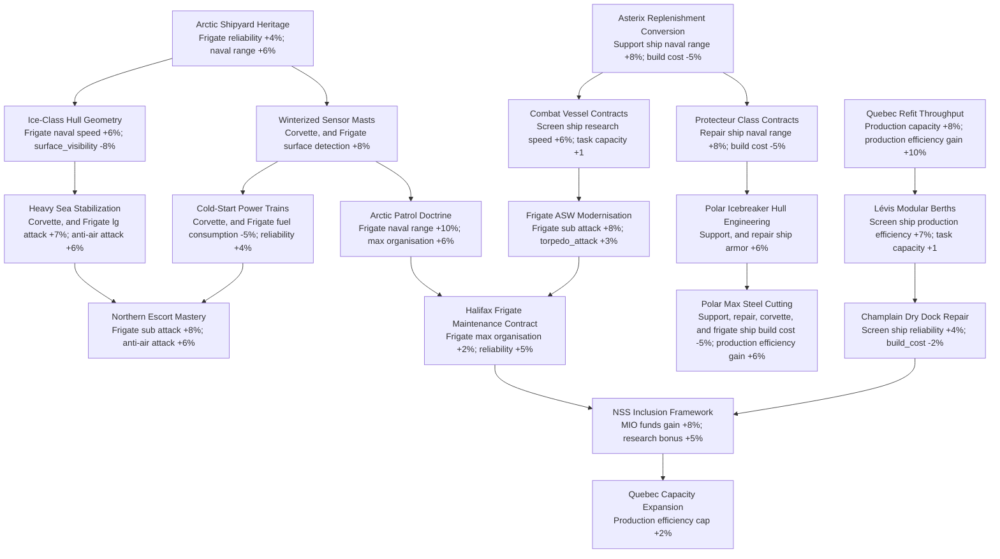
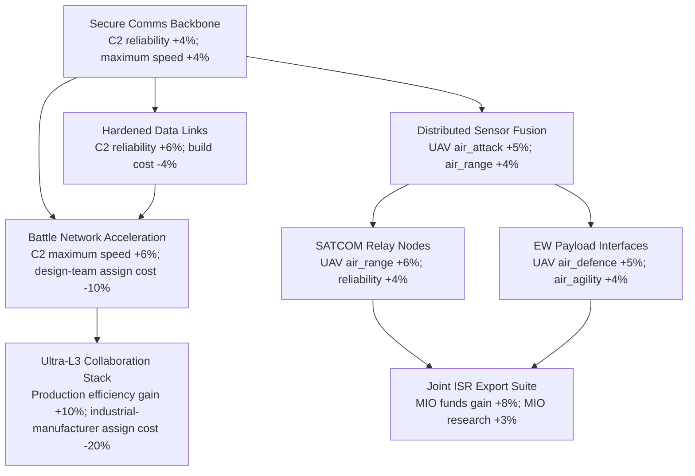
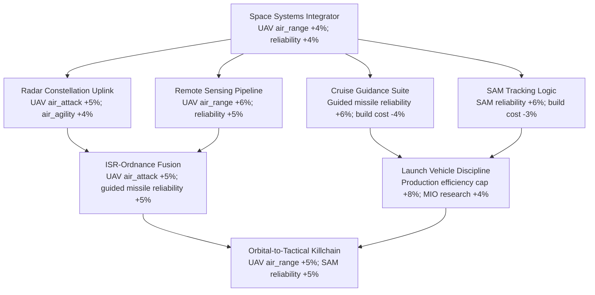
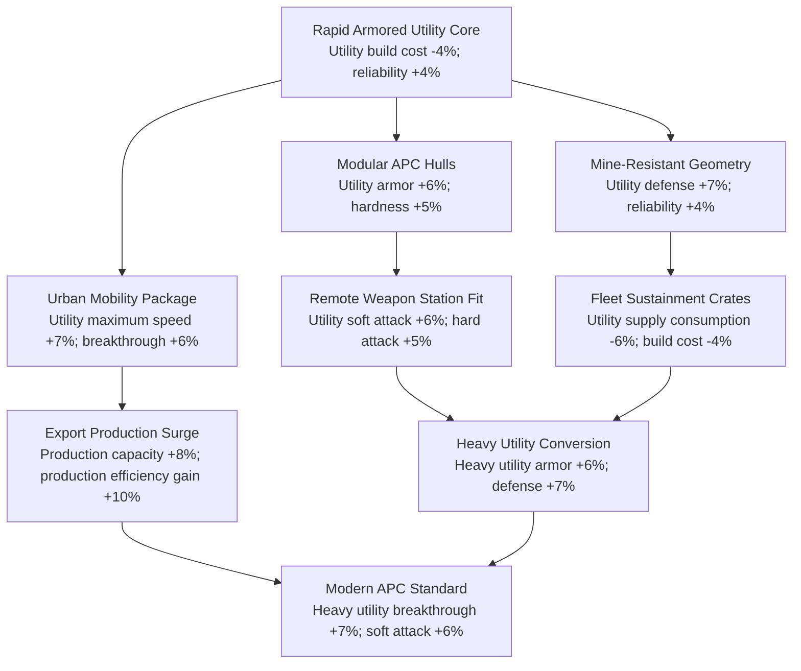

# Millenium Dawn's Canadian Awakening
Canada hasn't seed a good dusting off since it's initial work at the beginning of the mod. Some stuff was added to it, but overall it's fairly empty. Especially when you compare it to other medium powers such as Sweden, France, or Ukraine.

# Starting small
## MIO
While some of Canada's military industry was brought on-board when MIOs were introduced, several are still missing and they expose great production gaps. While in my propositions I highlights some area of specialisations and bonuses, they are not meant to be only that. They must still offer common bonuses to their area of expertise. Here are some I want to see added:

### Implementation rules
1. Bonuses to corvettes, frigates, and destroyers always apply to both the "regular" version and the "stealth" version.
2. Screen ships are corvettes, and frigates.

## Colt Canada / Diemaco
The sole producer of Canada's standard issue firearms. It should reflect the evolution of Canadian service weapons, from the C7 to the C25, whilst passing by the machineguns. It's current state is good, but it misses content regarding the C25 and its options.

### Bombardier
Bombardier - funilly enough has never built a bomber - is a Quebec based company that builds a wide variety of motor vehicles. They range from recreational aircrafts to large jet liners to snowmobiles. It also is a prime candidate to tie into the French Hapiness mechanics that is for now just flavor and is difficult to interact with.
Unfortunately I don't want to create a ground MIO *just* for utility vehicles, therefore I'd skip that part of their portfolio.

**Bombardier Défense**: MIO dedicated to large and light aircrafts, as well as drones. Whilst IRL they are dedicated to large aircrafts, only having them do that seems too restrictive. I'd wrap into it their civilian expertise building light aircrafts to give some variety. Furthermore, IRL Canada is moving more and more towards light jet fighters (F-35 vs Gripen competition) over medium-sized ones. Would encourage players to lean into it.

### Bell Textron
MIO specialized in helicopters. It's a large civilian manufacturer of helicopters, and is in charge of building and sustainement of the existing Griffon helicopter. Since it doesn't have a history of building dedicated gunships - and neither does the CAF operates them - I'd do as with Bombardier: make a case for light gunships.

### CAE
Another giant based in Quebec. It's main claim to fame is aircraft simulators production. I'd look into if it is possible to use a MIO to give passive boosts to a country. Otherwise, maybe investing into them could be made through decisions? If we go the MIO way, I'd also give them the Comms. & Coordinations line.

### Irving Shipbuilding
Another Canadian giant. Probably the largest shipyards in Canada. Let's give it some some bonuses towards destroyers since that's what they are building.

### Davie Shipbuilding
Shipyards, and another way to interact with the French hapiness by boosting investment into Quebec. Flavor-wise, I'd like to give them some bonuses towards negating weather impact on naval operations (naval detection, naval hit chance, naval speed, naval strike, positionning). This is due to their extensive work in the matter of building icebreakers and arctic capable warships.

### L3Harris
Civilian-Military hybrid specialized in the production of secure communications systems and powerplant technologies. They are also an excellent potential MIO for light drones.
To avoid cramping too many companies in the comms. space, I'd give them flavor perks with collaboration work with Ultra Intelligence & Communications. It's a company specialized in comms. equipment and related remote technologies based in Canada.

### Logistik Unicorps
They are THE light kit and clothing manufacturer for soldier and infantry in Canada. Unfortunately, they don't produce really anything visible in the gear that is produced in HOI4 nor MD. Therefore, I would have interactions with them done via decisions. They produce uniforms, socks, t-shirts, gloves, sleeping bags, raingear, boots, etc... I still have dozens of clothing pieces made from them and I am not about to run out even six years after leaving the Forces.

### MDA
One of, if not the largest space-oriented company in Canada. They build satelites and spy stuff. They also make remote piloted aircraft systems and radars. Hitherto, bonuses for UAVs (light aircrafts kind), and we'll also lean into the whole rocketry thing with cruise missiles and SAM missiles.

### Roshel
The newcomer star of utility vehicles and light armored vehicles. MIO for that will give bonuses to light and heavy utility vehicles and APC.

Sources:
- https://canadiandefencereview.com/directory/ : Directory of the defence industry

## Focus tree
### Naval
The submarine purchase issue of 2025-2026 was a big deal. Have a choice between two focuses between the historical German Type 212CD submarine purchase, and the alternative South Korean KSS-III submarine.